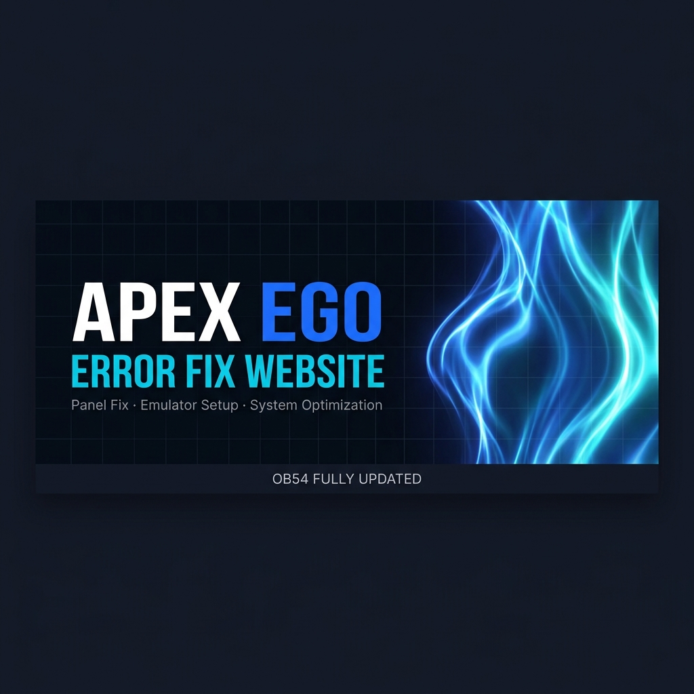

# ⚡ APEX ELITE SUPPORT HUB

<div align="center">



[](https://nodejs.org)
[](LICENSE)
[](https://render.com)
[](https://discord.gg/v766g2PNn6)

**Apex Elite Support Hub** is an all-in-one troubleshooting dashboard, driver runtime manager, and configuration portal engineered for APEX panels, emulators, and high-performance gaming optimization.

[Live Demo](http://localhost:3000) • [Discord Community](https://discord.gg/v766g2PNn6) • [Report Issues](https://github.com/paponbasak99/apexsupport/issues)

</div>

---

## 🌟 Key Features

- **🎯 Apex Free Panel Hub:** Dedicated distribution for official free panel editions:
  - `Free Premium C#` & `Free Premium C++`
  - `Free Internal`
  - `Free Bypass` *(with automated VIP notice modal)*
  - `Free Optimizer`
  - `Free Aimkill`
- **🛡️ Cloudflare Turnstile Human Verification:** Intelligent security gateway protecting downloads and sensitive endpoints from bots and scrapers.
- **💾 Dual-Mode Persistence Architecture:**
  - **SQLite WAL Mode** for persistent server environments (Docker, Render, VPS).
  - **Graceful JSON Fallback** for read-only serverless platforms (Vercel).
- **🎨 Cyberpunk Glassmorphism UI:** Deep obsidian frosted glass, vibrant neon glow accents, smooth gradient waves, and tactile micro-animations.
- **📱 Fully Responsive Design:** Dynamic multi-breakpoint grid system tailored for Mobile, Tablet, and Ultrawide displays.
- **🔒 Production Security Hardening:**
  - Strict Content Security Policy (CSP) via Helmet.
  - Granular API Rate Limiting (`express-rate-limit`).
  - Anonymized click tracking and analytics logging.

---

## 📂 Project Architecture

```plaintext
apex-support-hub/
├── data/
│   ├── database.sqlite      # SQLite local database (WAL mode)
│   ├── keys.json            # Dynamic access keys configuration
│   └── links.json           # Master download links mapping
├── public/
│   ├── assets/              # Icons, banners, logos, and custom folder graphics
│   ├── css/
│   │   ├── styles.css       # Core design system & component styles
│   │   ├── home-redesign.css# Enhanced hero & navigation styles
│   │   └── gradient-waves.css # Animated canvas & background waves
│   ├── js/
│   │   ├── script.js        # Navigation, modal system & download controller
│   │   ├── main.js          # Dynamic card loader & API integration
│   │   ├── turnstile.js     # Cloudflare verification challenge client
│   │   └── gradient-waves.js# Canvas ambient wave animations
│   └── index.html           # Main single-page application
├── scripts/
│   ├── audit_mobile.js      # Mobile responsiveness validator
│   ├── link-audit.js        # Link health check utility
│   └── obfuscate.js         # Production client-side script obfuscation
├── src/
│   └── server.js            # Express application server & API routes
├── .env.example             # Template for environment configuration
├── render.yaml              # Render blueprint deployment specification
├── vercel.json              # Vercel serverless deployment specification
└── package.json             # Project dependencies and lifecycle scripts
```

---

## 🚀 Quick Start

### 1. Prerequisites
- [Node.js](https://nodejs.org/) version **18.0.0** or higher
- `npm` or `pnpm`

### 2. Clone the Repository
```bash
git clone https://github.com/paponbasak99/apexsupport.git
cd apexsupport
```

### 3. Install Dependencies
```bash
npm install
```

### 4. Configure Environment Variables
Copy `.env.example` to create your `.env` file:
```bash
cp .env.example .env
```
Update `.env` with your preferred settings:
```env
PORT=3000
NODE_ENV=development
SESSION_SECRET=your_super_secret_session_key
ADMIN_PASSWORD=your_secure_admin_password
ADMIN_SECRET_KEY=your_admin_secret_key
DISABLE_ADMIN_IP_CHECK=true
TURNSTILE_SITE_KEY=your_cloudflare_turnstile_site_key
TURNSTILE_SECRET=your_cloudflare_turnstile_secret_key
```

### 5. Launch the Application
```bash
npm start
```
Open **[http://localhost:3000](http://localhost:3000)** in your browser.

---

## ⚙️ Environment Variables

| Variable | Description | Default |
| :--- | :--- | :--- |
| `PORT` | HTTP server listening port | `3000` |
| `NODE_ENV` | Environment mode (`development` / `production`) | `development` |
| `SESSION_SECRET` | Secret key used for session cookie signing | &mdash; |
| `ADMIN_PASSWORD` | Password for the administrative control panel | &mdash; |
| `ADMIN_SECRET_KEY` | Secondary verification key for administrative APIs | &mdash; |
| `DATABASE_PATH` | Filepath to SQLite database file | `data/database.sqlite` |
| `TURNSTILE_SITE_KEY` | Cloudflare Turnstile public site key | &mdash; |
| `TURNSTILE_SECRET` | Cloudflare Turnstile secret key for server verification | &mdash; |
| `DISABLE_ADMIN_IP_CHECK`| Skip IP whitelisting for admin portal access | `true` |

---

## 🚢 Deployment Guides

### Deploy to Render
This repository includes a pre-configured [`render.yaml`](render.yaml) blueprint:
1. Fork or push this repository to GitHub.
2. In the [Render Dashboard](https://dashboard.render.com/), choose **Blueprints** and select this repo.
3. Render automatically provisions a Node.js web service and a persistent 1GB SSD disk for the SQLite database.

### Deploy to Vercel
This repository includes a pre-configured [`vercel.json`](vercel.json):
1. Install the Vercel CLI: `npm i -g vercel`
2. Run `vercel` in the project root.
3. The server runs seamlessly in serverless mode, using [`data/links.json`](data/links.json) for read-only fallback.

---

## 🛡️ Security

- **Content-Security-Policy (CSP):** Configured via Helmet to permit necessary Cloudflare Turnstile scripts while preventing cross-site scripting (XSS).
- **Rate Limiting:** Protects API endpoints against brute force and DDoS attacks.
- **Secret Hygiene:** Database credentials, secrets, and SQLite files are strictly excluded from source control via `.gitignore`.

---

## 📄 License

This project is licensed under the [MIT License](LICENSE).

---

<div align="center">
Built with ❤️ by <strong>Papon Basak</strong> • Community Support on <a href="https://discord.gg/v766g2PNn6">Discord</a>
</div>
